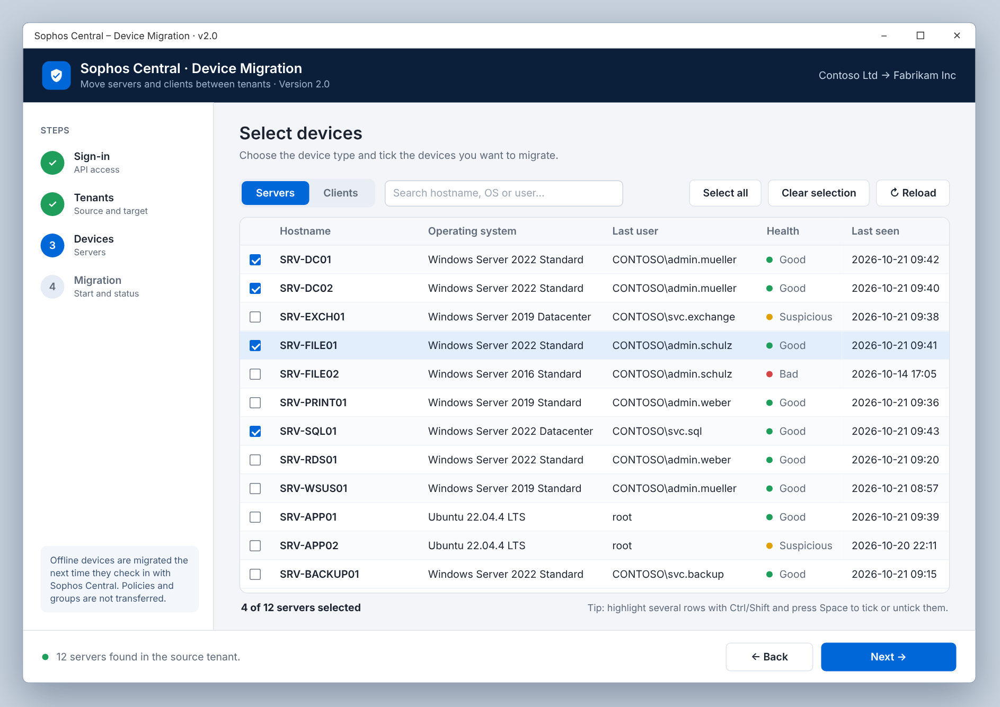
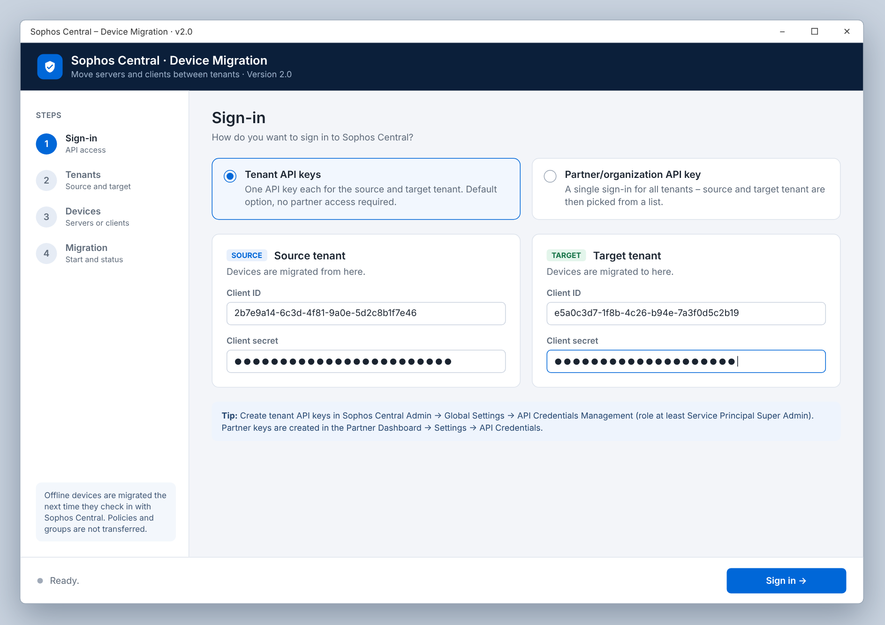
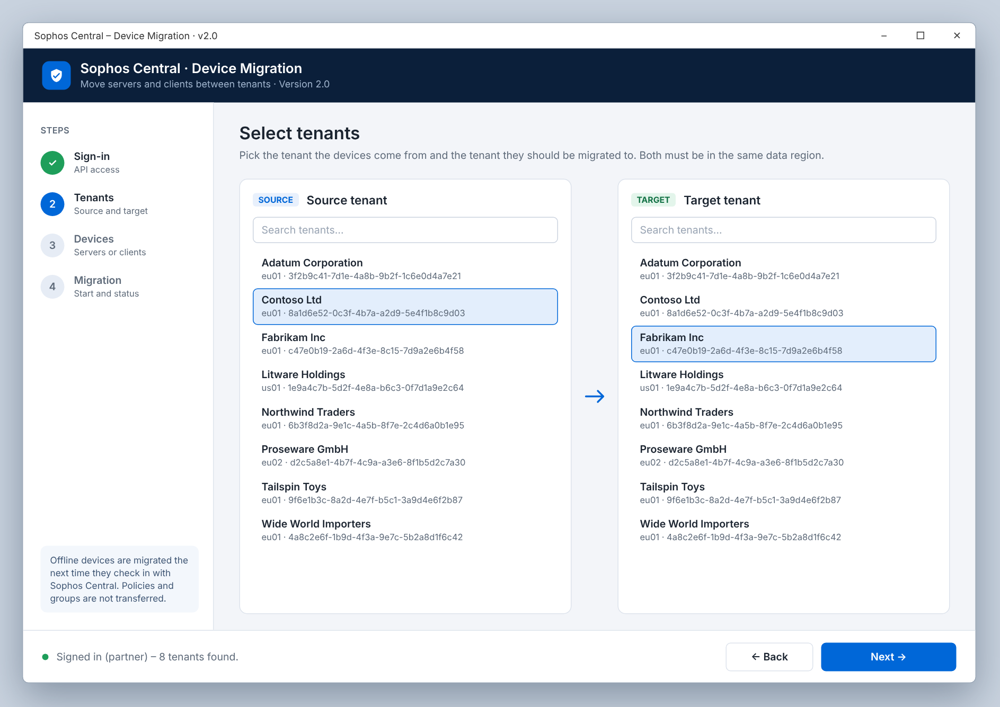
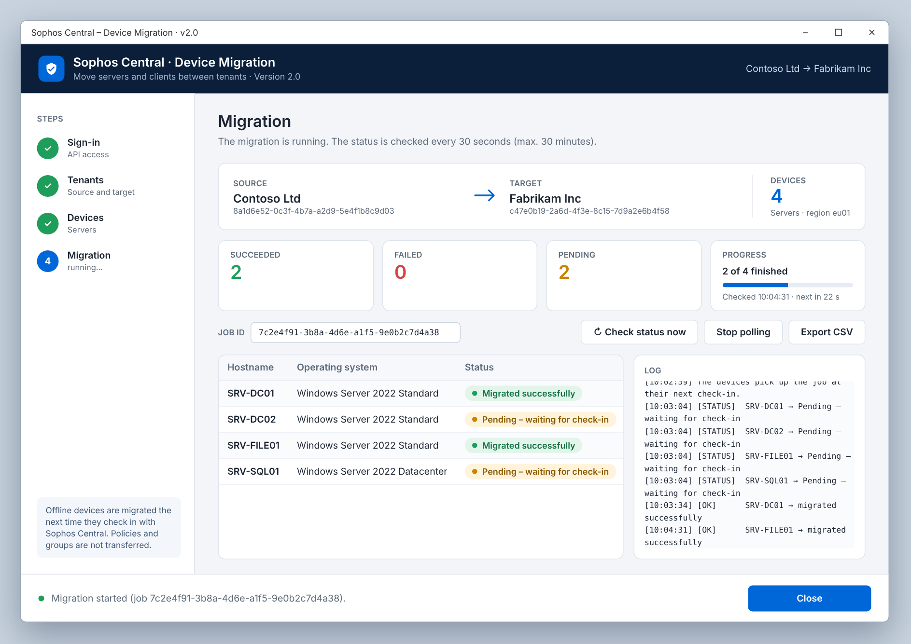
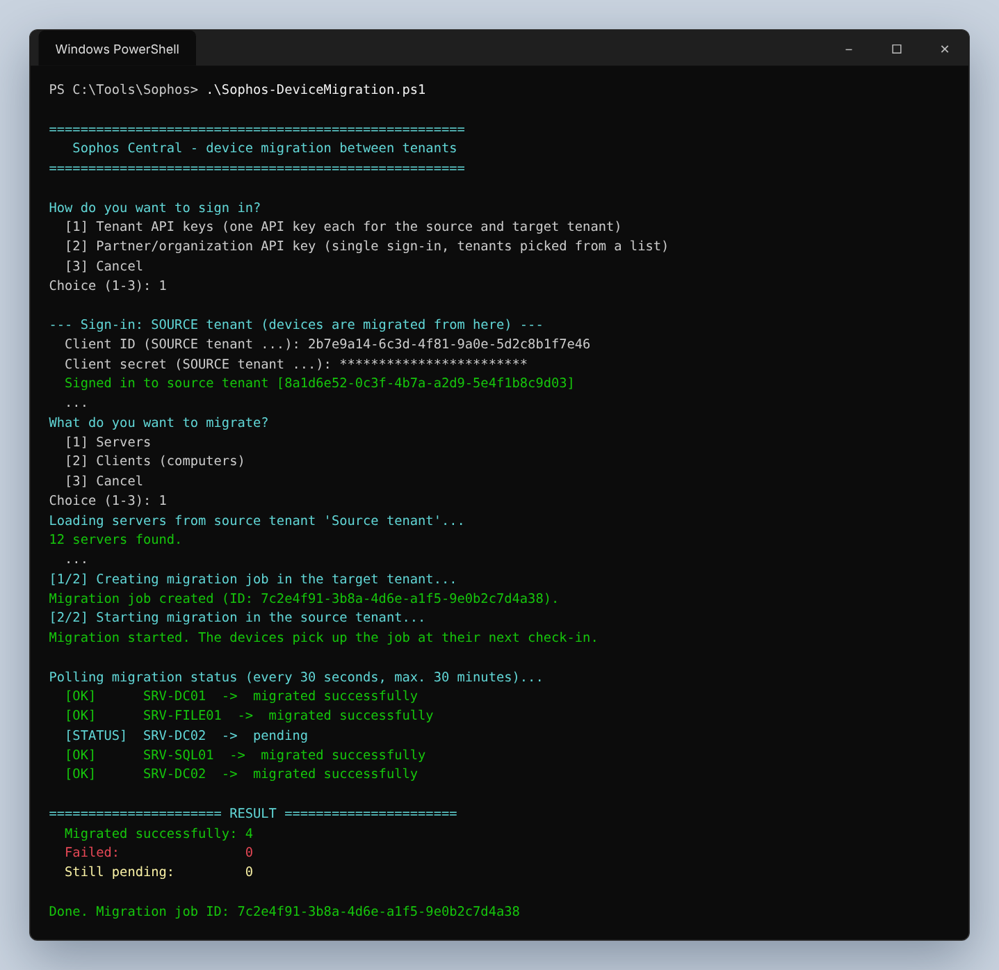

# Sophos Central Device Migration

Move Sophos Central devices (servers or clients) from one tenant to another
through the official Sophos Central API, with a modern Windows GUI or as a
guided console script.

Sign in with the API keys of both tenants or with a single partner/organization
key, pick the devices from a searchable list (or migrate all at once), start the
migration and follow the status of every device live. Offline devices are
migrated automatically on the server side the next time they check in with
Sophos Central.



## Contents

- [Quick start](#quick-start)
- [Graphical user interface](#graphical-user-interface)
- [Console script](#console-script)
- [Creating API keys](#creating-api-keys)
- [Requirements](#requirements)
- [Notes and limitations](#notes-and-limitations)
- [Versions](#versions)

## Quick start

1. Download the latest package from
   [Releases](https://github.com/adblocker-1/sophos-api-device-migration/releases)
   and extract it.
2. Create API credentials for the source and target tenant
   (see [Creating API keys](#creating-api-keys)).
3. Double-click **`Start-GUI.cmd`**, or run one of the scripts in PowerShell:

   ```powershell
   .\Sophos-DeviceMigration-GUI.ps1   # graphical user interface
   .\Sophos-DeviceMigration.ps1       # console script
   ```

## Graphical user interface

`Sophos-DeviceMigration-GUI.ps1` guides you through the migration in four steps.
The step list on the left shows where you are. All API calls run in the
background, so the window stays responsive, and access tokens are renewed
automatically during long sessions.

### Step 1: Sign-in

Choose the sign-in method:

- **Tenant API keys** (default): enter the client ID and client secret of the
  **source tenant** and the **target tenant**. No partner access is required.
- **Partner/organization API key**: sign in once. You pick the source and
  target tenant in the next step.

The tool checks that each key has the right type, that source and target are
different tenants, and that both are in the same data region.



### Step 2: Select tenants (partner/organization sign-in only)

Pick the source tenant on the left and the target tenant on the right. Both
lists can be searched by name or tenant ID. If both entries are the same tenant
or the regions differ, a warning is shown right away.

With tenant API keys this step is skipped automatically.



### Step 3: Select devices

- Switch between **Servers** and **Clients**.
- Filter the list by hostname, operating system or last user.
- Tick devices individually, or use **Select all** / **Clear selection**.
  *Select all* only affects the devices currently visible, so you can combine
  it with the search.
- To tick several devices at once, highlight rows with **Ctrl/Shift** and press
  **Space**.
- Click a column header to sort. The health status is shown in color.


### Step 4: Migration

Review the summary and click **Start migration**. After a confirmation prompt
the tool runs the two-step handshake of the Sophos API: it creates the job in
the target tenant, then confirms it in the source tenant.

You then follow the progress live:

- **Status per device**: *Migrated successfully*, *Failed* or
  *Pending – waiting for check-in*
- **Counters** for succeeded, failed and pending devices, plus a progress bar
- **Log** with every status change
- **Check status now** polls immediately. The automatic check runs every 30
  seconds for up to 30 minutes.
- **Export CSV** saves the result. The list separator matches your regional
  settings, so the file opens directly in Excel.



You can close the window at any time. The migration continues on the server
side, and the job ID shown lets you look it up later.

## Console script

`Sophos-DeviceMigration.ps1` offers the same features as a dialog in the
console:

1. **Sign-in method**: `[1] Tenant API keys` or
   `[2] Partner/organization API key`. With option 2, the tenants are picked
   from a GUI list.
2. **What to migrate**: `[1] Servers`, `[2] Clients`, `[3] Cancel`.
3. **Scope**: `[1] All` devices, or `[2] Select individually` in a GUI list
   (hostname, OS, last user, health, last seen) with multi-selection.
4. **Confirmation**, then the migration starts.
5. **Status per device**: the script polls the migration status and reports
   `migrated successfully`, `failed` or the current status for each device,
   followed by a summary.

All input is requested interactively. Client secrets are entered hidden.



## Creating API keys

- **Tenant API key** (option 1, one per tenant):
  *Sophos Central Admin → Global Settings → API Credentials Management →
  Add Credential*. Migrations need at least the role
  *Service Principal Super Admin*.
- **Partner API key** (option 2, optional):
  *Sophos Partner Dashboard → Settings → API Credentials*.

## Requirements

- Windows PowerShell 5.1 or PowerShell 7+.
  - The **GUI requires Windows** (WPF).
  - For the GUI lists in the **console script** under PowerShell 7, install the
    module `Microsoft.PowerShell.GraphicalTools`. Without it, the script falls
    back to a console selection automatically.
- API credentials for the source **and** target tenant: either two tenant keys
  or one partner/organization key.
- Source and target tenant must be in the **same data region**. This is a
  limitation of the Sophos migration API, and both scripts check it.

## Notes and limitations

- Offline devices stay *pending* and are migrated the next time they check in
  with Sophos Central. You can stop the script or close the window at any time.
  The migration continues on the server side.
- Policies and groups are not transferred. The devices arrive in the target
  tenant with the default configuration (behavior of the Sophos API).
- `Start-GUI.cmd` starts PowerShell with `-ExecutionPolicy Bypass`, so the
  downloaded script runs without changing your execution policy.

## Versions

Changes per version are listed in the [CHANGELOG](CHANGELOG.md). Packages with
all scripts are on the
[Releases](https://github.com/adblocker-1/sophos-api-device-migration/releases)
page.

> The screenshots show the tool with sample data.
